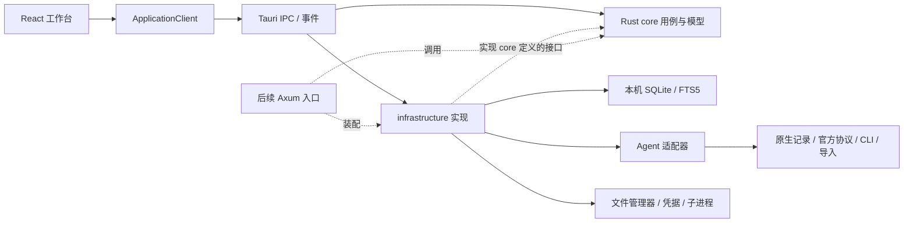

# AI_MP_AgentTasks 系统架构

架构文档版本：v0.4.0 · 日期：2026-10-25 · 产品版本：v0.3.0。已实现统一 SQLite 展示投影、Codex 手动同步与最终答复过滤；独立 Rust core、通用 Agent 适配层及其他真实连接器尚未实现。

本文件为代码仓库内正式架构入口，按用户最新要求落在 `H:\PROJECTS\PARA\AI_MP_AgentTasks`。外部目录 `H:\PARA\2.Area\AI中台_Agent都在干什么_20261026` 继续存放产品文档、参考图、概念图和中间产物。此前外部 v0.1 架构文档保留为历史；后续系统架构更新以本仓库为准。

## 1. 架构决定

**Tauri 2 + React + TypeScript + Rust + SQLite，本地优先、模块化单体。**

用户已明确后端使用 Rust。桌面端用 Tauri IPC 调用 Rust 核心；以后独立后端用 Axum 复用核心。首期不额外启动 HTTP 服务。目标平台为 Windows、macOS、Linux，逐平台构建与验收。

首期解决：不同 Agent 有哪些项目、有哪些会话、各会话做什么、如何查找和打开来源。真实原生会话交互在下一阶段逐工具接入。调用模型 API 新建对话不能代表接续原 Agent 会话。

## 2. 运行结构与依赖方向



图中的依赖箭头表示代码引用。运行时由 desktop 入口装配 infrastructure，注入 core 接口；core 调用抽象接口完成用例。**core 不引用 infrastructure 或 Tauri**，避免反向依赖。

| 模块 | 责任 | 禁止跨越的边界 |
|---|---|---|
| React UI | 四栏布局、树、搜索、分页消息、用途编辑、形象与用量 | 不读取本地来源、不直接访问 SQL 或 shell |
| ApplicationClient | 统一前端业务调用，首期 TauriClient 实现 | 不承载归类、去重、用量计算规则 |
| desktop/src-tauri | 命令校验、依赖装配、窗口和应用生命周期 | 不堆放领域逻辑 |
| core | 项目映射、会话、用途、任务、用量解释、搜索用例、适配器接口 | 不依赖桌面框架和数据库驱动 |
| infrastructure | SQLx 仓储、来源适配器、监听、平台服务、日志 | 不直接控制 React 状态 |
| contracts | 从 Rust DTO 生成 TypeScript 类型 | 不手工维护两份业务模型 |

## 3. 工程目录

以下仍以目标目录为主。v0.3.0 在 `apps/desktop/src-tauri/src/codex.rs` 实现只读来源与写入前过滤，在 `store.rs` 实现统一 SQLite 迁移、手动同步和查询，由 `main.rs` 暴露四个受限 IPC 命令，前端 `src/codex.ts` 负责调用；目标 core/infrastructure 分层仍未完成。演示数据仍放在前端本地存储；真实可见正文保存于应用数据库，不复制到 localStorage。接入第二个来源前，应把共享模型与适配接口提取到 core，把 JSONL 读取移到 infrastructure。

```text
AI_MP_AgentTasks/
  README.md
  ARCHITECTURE.md
  docs/
    architecture/contracts.md
    adr/decisions-v0.1.md
  Cargo.toml                     后续 Rust workspace
  package.json                   后续前端 workspace
  apps/desktop/
    src/
      features/tools/            工具栏与连接状态
      features/projects/         统一项目与原生项目树
      features/sessions/         会话、消息、任务、用途
      features/search/           搜索与命中定位
      features/inspector/        形象、模型和用量面板
      lib/client/                ApplicationClient / TauriClient
    src-tauri/                   装配、命令、事件、capabilities
  crates/core/src/
    domain/                      实体、ID、状态、规则
    application/                 查询、归类、索引调度等用例
    ports/                       仓储、适配器、系统服务接口
  crates/infrastructure/src/
    persistence/                 SQLx / SQLite
    adapters/                    codex、claude 等，按验证结果增加
    platform/                    路径、文件定位、凭据、进程
    indexing/                    增量来源读取与监听
  packages/contracts/            生成的 TS 类型
  migrations/                    自有数据库迁移
  tests/fixtures/                脱敏来源版本样例
  tests/integration/             索引、归类、接口契约测试
```

Axum 确有需要再加 `apps/server`。Rust stable、Tokio、SQLx、notify、tracing 为推荐依赖；具体版本在 P0 验证后锁定，提交两端 lockfile。

## 4. 数据模型与两套导航

| 实体 | 身份与关系 |
|---|---|
| ToolDefinition | 宿主工具类型、显示名称、头像、默认形象；与模型分开 |
| Connection | 工具的账号/profile/设备连接实例、凭据引用、探测时间 |
| NativeProject | 连接内原生 ID、parent_id、来源目录和名称；保留树结构 |
| HubProject | 中台统一项目、说明、标签 |
| ProjectMapping | HubProject 与 NativeProject 的关联和确认依据 |
| Session | 连接内原生会话 ID、原生项目、来源标题、来源定位符、更新时间 |
| SessionProjectLink | 会话级中台归类；优先于所属原生项目的映射 |
| SessionAnnotation | 用户标题、用途、备注、标签，与来源数据分别存储 |
| Message | 会话内原生消息 ID、role、正文、源版本和顺序 |
| TaskItem | 会话的任务、目的、状态、证据与来源 |
| UsageObservation | 指标、值、范围、来源、时间、reported/estimated/unknown |
| SyncCursor | 来源指纹、偏移/版本、最后成功检查点 |
| Run（后期） | 原生运行 ID、会话、幂等请求 ID、执行状态和审批引用 |

唯一约束以 `(connection_id, native_session_id)` 为主；消息以会话与原生消息 ID 去重。没有可靠原生 ID 时，适配器必须明确生成稳定来源定位符并说明限制，不能只按标题去重。

按项目视图：HubProject → 带工具名称和圆形头像的 Session → 用途与任务。原生项目映射提供默认归类，会话级归类提供覆盖；覆盖允许多个目标时按集合展示，避免重复行。按工具视图：Tool → Connection（需要时）→ 原生项目树 → Session。无原生项目的工具显示“无原生项目”，不杜撰目录。

两套视图引用相同会话。相同规范化主目录自动归入同一 HubProject；不同工具或不同设备同名项目不自动合并，父子目录也不因包含关系合并，其他匹配先建议再确认。来源不可读时保留缓存和用户备注，标明最后同步时间。v0.3 的数据库字段与保留规则详见 `docs/architecture/unified-database-v0.3.md`。

用途优先级：用户说明 > 可追溯的来源描述 > 明确标注自动生成的摘要 > 未整理。自动摘要为后续可选功能，默认不外发正文。任务状态记录 reported / verified 等证据层级，不把模型自述完成当作验收完成。

## 5. Agent 接入

每个适配器分别声明 discovery、list_projects、list_sessions、read_messages、read_usage、open_native_session、resume_session、stream、cancel、approval 能力，附状态、原因、来源版本和检测时间。

优先验证官方结构化接口；其次验证 CLI；只读本地记录用于展示投影；导出文件作为补充。不同读写入口必须保持同一来源身份。v0.3 仅 Codex 已真实接入；Kimi、千问办公、WorkBuddy、Trae CN 的本机结构调查深度与未验证项见 `docs/architecture/local-source-investigation-v0.3.md`。

先调研 Codex、Claude Code，再按可访问数据源接入 WorkBuddy、TraeWork、千问办公、Coze 等。当前 Codex 聊天内置工具不能默认当作产品可调用 API。

适配器第一版随 Rust 编译，用普通 trait/枚举注册。需要崩溃隔离或第三方语言运行时再子进程化，不使用 Rust 动态库 ABI。来源数据库保持只读；自有迁移仅作用于中台数据库。

## 6. 同步与搜索

来源发现 → 先索引项目/会话元数据 → 分批索引正文 → 事务提交与检查点 → 通知 UI 重读。监听去抖并配周期校准，支持取消、有限并发和按来源退避。

半行 JSONL 等待补全；截断、替换、轮转通过来源指纹识别。索引写入和 cursor 必须同事务提交。来源锁定、权限拒绝、未知格式、损坏记录分别报错。索引删除或重建不删除用户映射和备注。

SQLite 使用外键、WAL、busy timeout 和收敛的写并发。FTS5 trigram 计划用于至少三字符的中英文子串搜索，短词用有范围/时限的转义 LIKE 回退。查询参数绑定、FTS 语法转义、中文两字词和路径搜索都纳入验证。首期不引入向量库或独立搜索服务。

搜索返回工具、项目、会话、命中摘要和消息定位；标题、用途、标签和正文分别可筛选。结果和消息分页，初始每页 50 / 100 条。首轮索引要显示进度、覆盖范围和最后成功时间。

## 7. 上下文、形象与状态

头像与立绘是可配置显示资源，与工具类型及模型分开；右侧切换当前会话的工具形象、模型与用量，支持折叠。

输入、输出、缓存读取/写入、累计使用、当前上下文、模型窗口、账号限额为不同指标。指标记录 scope、source、observed_at、measurement，未知用 null。分子分母必须同范围才能显示上下文占比；累计 Token 不能代替当前占用。模型切换或压缩后刷新范围。

连接状态、同步状态、执行状态分别维护。已有日志不代表当前运行中；断线且无法确认运行结果时显示 unknown，不自动重发指令。

## 8. IPC、系统集成与后续服务端

具体命令、事件和错误契约见 [接口契约](docs/architecture/contracts.md)。TauriClient 可在以后增加 HttpClient 实现，但两者调用相同应用用例。

应用数据走系统应用目录，不硬编码 H 盘。活动 SQLite 不放网盘目录；备份使用一致性快照。凭据走系统凭据库，Linux 服务不可用时明确失败，不静默回退明文。

Windows/macOS/Linux 分别实现文件 reveal；Linux 无选中文件能力时打开父目录并明确反馈。受控命令使用固定程序与独立参数，不拼接 shell 文本。路径规范化、来源范围校验及符号链接越界检查在 Rust 完成。

Tauri capabilities 最小授权；命令再次检查参数与能力。Markdown 禁止原始 HTML、过滤 URL；远端内容不能在有本机权限的页面运行脚本。日志脱敏，不默认保存完整消息正文。

后续 Axum 提供 HTTP/JSON 与 SSE，补身份认证、权限、TLS、断线恢复。服务器无法直接读客户端本地 Agent 文件或打开客户端资源管理器；远程采集需在来源设备增加采集端与设备路径映射，届时单独设计。

## 9. 交付与验收

| 阶段 | 验收条件 |
|---|---|
| P0 工程与来源验证 | Windows Tauri/Rust 构建；SQLite FTS5 与中文搜索；至少一个真实来源保留原生会话 ID；验证实际可用能力 |
| P1 索引工作台 | 至少两个来源、两种导航引用同一会话、搜索、用途编辑、用量未知态、可用时原会话跳转 |
| P2 原生会话交互 | 一个工具恢复同一原会话；核对原生 ID 和消息；验证发送、流式、取消、审批、异常恢复 |
| P3 三端发布 | 三端分别验证布局、路径、构建、迁移、凭据、文件定位和适配器支持矩阵 |
| P4 独立 Rust 后端 | Axum 复用核心，明确认证、远程采集及设备权限边界 |

正确性：不按同名误合并；重复同步不重复建会话；重建不丢用户数据；来源只读；部分失败保留可用缓存。

性能目标尚未实测：1 万会话/100 万消息，热索引标题搜索 P95 < 300ms，正文 < 1s；短词搜索单独报告。测试报告记录硬件、系统、语料规模、覆盖率和冷/热状态。首次索引耗时另计。

架构决策依据见 [ADR](docs/adr/decisions-v0.1.md)。实际构建与界面验证以对应版本记录为准。产品 v0.1 的 8 个工具为 ChatGPT、Claude Code、Trae（CN）、Kimi、Deepseek Harness、Workbuddy、豆包工作、千问办工，取代早期候选清单；产品展示保留用户原始命名。

## v0.2 实施补充

已实现 crates/local-source 独立 Rust 只读模块，Tauri IPC 调用。浏览器预览需显式启用同一程序的 --source-server 模式（Axum，127.0.0.1:1421，Host/Origin 校验），桌面常规模式不监听端口。此项替代首期不需要预览后端的假设；自有 SQLite 索引缓存仍未实现。默认来源为 Codex 本地，非网页 ChatGPT 历史。实际验收边界见 v0.2 记录。
